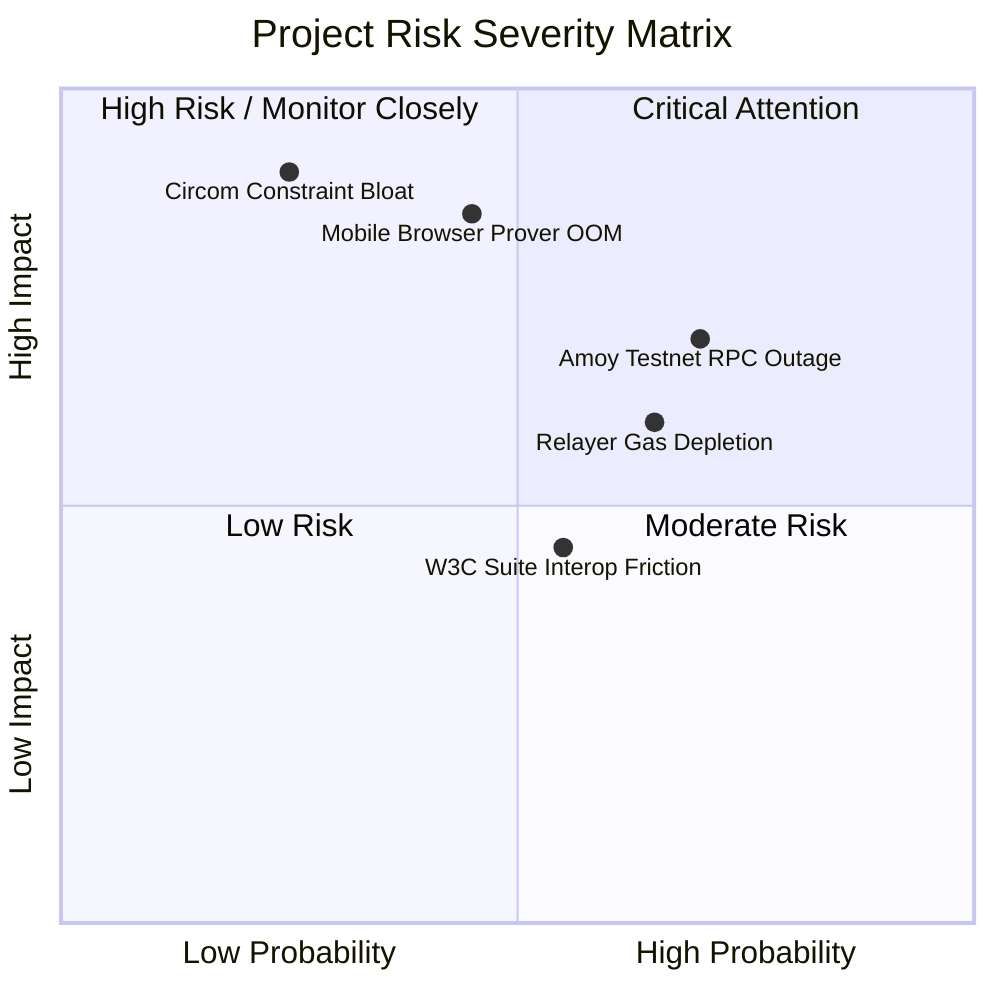

# RISK_REGISTER.md — Technical Risk Matrix & Mitigation Strategy

> **Document ID**: DOC-PM-004  
> **Status**: Confirmed Technical Specification

---

## 1. Technical Risk Matrix

---

## 2. Risk Log & Mitigation Register

| Risk ID | Risk Description | Probability | Impact | Mitigation Strategy | Contingency Plan |
| :--- | :--- | :---: | :---: | :--- | :--- |
| **RSK-01** | **Mobile Browser Out-of-Memory (OOM)**: Low-end mobile devices crash when computing Groth16 proofs in browser. | Medium | High | Optimize Circom constraints to $\le 3,650$; use 14-bit comparators; execute in Web Worker with $65\,\text{MB}$ memory cap. | Provide fallback: delegate proving to a trusted client-side desktop companion or opt for standard QR verification. |
| **RSK-02** | **Polygon Amoy RPC Outage**: Public testnet RPC nodes rate-limit or fail during live demo. | High | High | Implement `FallbackProvider` cycling through Alchemy, QuickNode, and Polygon public nodes. | Run a local Hardhat node (`localhost:8545`) with instant mock switching. |
| **RSK-03** | **Relayer Gas Wallet Exhaustion**: High volume of issuance transactions depletes relayer POL balance. | High | Medium | Automated Prometheus alert when balance $< 5.0\,\text{POL}$; batch issuance transactions. | Automated top-up faucet script. |
| **RSK-04** | **Circom Underconstrained Circuit**: Missing constraint allows invalid witness generation. | Low | Critical | Fuzz testing with `circom_tester`; verify all signal assignments have corresponding equality constraints. | Formal verification using SMT constraint solvers. |
| **RSK-05** | **W3C VC Proof-Suite Interop**: Custom BabyJubjub signature suite not natively recognized by generic wallets. | High | Low | Implement dual-signature representation (Ed25519 for standard W3C, BabyJubjub for Circom ZK). | Document custom cryptographic adapter clearly in specifications. |

---

## 3. Unresolved Technical & Research Questions

1. **In-Circuit Holder Ownership Binding**: In the MVP, holder presentation binding is enforced through off-circuit verifier nonces. How can we most efficiently prove holder private key ownership directly inside the Circom circuit without doubling constraint counts?
   - *Status*: Under active research for Post-MVP.
2. **Recursive SNARK Transcript Aggregation**: Proving full 4-year degree completion across 40 individual course grades using Halo2 or Nova folding schemes.
   - *Status*: Slated for Phase 3 research roadmap.
